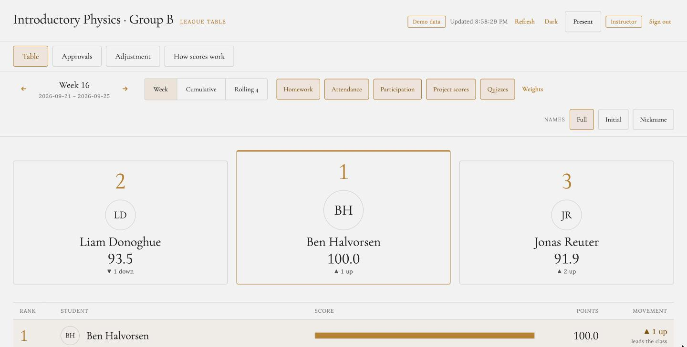

<div align="center">

# League Table

> A live scoreboard that ranks a university class fairly and shows every student how the score was worked out.

[](https://github.com/educatorsRlearners/league-table/actions/workflows/ci.yml)
[](LICENSE)
[](https://www.python.org)
[](https://fastapi.tiangolo.com)
[](https://github.com/astral-sh/uv)
[](#installation)
[](https://league-table-prod.onrender.com)

</div>

Instructors rank students each week on criteria they choose. A plain ranking punishes students who work or care for children and elders. League Table asks each student for weekly hours of work, child care, and elder care. It converts them to weighted hours. It then multiplies the score by a capped factor. Each weighted hour adds 0.01 to the factor, up to x1.25. Scores stop at 100. A criterion with no entry drops out and the remaining weights rescale, so missing data never counts as zero.

The page shows a podium of the top three, a ranked list with score bars and movement since last week, and a breakdown of each score. Classmates see only the final adjusted score and rank. Instructors see a weekly risk digest with five evidence-backed signals and log private outreach notes. After login, a student sees the class ranking and a full breakdown of their own score; an instructor sees every class they teach, each student's breakdown, and the risk digest. The backend enforces scoring, ranking, risk, and roles.

<div align="center">

</div>

## Installation

Choose Docker or a local install.

**Docker.** Install Docker, then start the database and the app from the repository root:

```sh
docker compose up --build
```

The app runs at <http://localhost:8000> on Postgres, and the `db-data` volume keeps its data. Stop it with `docker compose down`.

**Local.** Install [uv](https://docs.astral.sh/uv/) and `make`, then run two commands:

```sh
make install
make run
```

`make run` serves the app at <http://localhost:8000> on in-memory SQLite, so each run starts empty and reseeds.

## Usage example

Open <http://localhost:8000>. The API docs are at <http://localhost:8000/docs>. The app seeds two demo classes of 24 students each (PHYS 204 and DATA 118).

Sign in on the login screen as `i1` (the instructor) or `s01` (a student in class `c1`), or call the API with the same value as a Bearer token:

```sh
curl -H "Authorization: Bearer i1" "http://localhost:8000/classes/c1/ranking?week=w5"
```

The demo tokens are public and unsigned; a production deployment needs signed identity tokens.

Live demos run on Render with Neon Postgres: [dev](https://league-table-dev.onrender.com) and [prod](https://league-table-prod.onrender.com). Log in as `demo-instructor`, `demo-amara` (class `c1`), or `demo-camila` (class `c2`). The free services sleep when idle; the first request can take up to a minute.

Reference docs:

- [Features](_docs/features.md)
- [API and auth](_docs/api.md)
- [Architecture](_docs/architecture.md)
- [Deployment](_docs/deployment.md)
- [Observability and the fault switch](_docs/observability.md)

## Development setup

```sh
make check      # lint, backend tests, and compose port guard; CI runs this
make test-all   # every suite; needs Docker and Node
```

[Testing](_docs/testing.md) describes each suite. [Status](_docs/status.md) lists what is built and what remains. [Backend README](backend/README.md) covers `DATABASE_URL` and integration tests. [Product spec](_docs/spec.md) defines the scoring rules.

## Release history

* 2026-10-22 ADD Alert rule for failing commitment submissions, with a demo fault switch to trigger it (#82, #83)
* 2026-10-21 ADD OpenTelemetry traces, metrics, and logs for the commitment journey (#80)
* 2026-10-20 ADD Render Blueprint for dev and prod; CD deploys dev after CI and prod on manual dispatch (#74, #77)
* 2026-10-20 ADD CI on every pull request and `make test-all` (#63, #70)
* 2026-10-20 CHANGE Reconnect to Neon after scale-to-zero with `pool_pre_ping` (#76)
* 2026-10-20 FIX Pin Render services to Frankfurt (#75)
* 2026-10-19 ADD WCAG 2.2 AA login screen and league table (#53)
* 2026-10-19 ADD Minimal Present mode that hides hours, factors, and approvals (#52)
* 2026-10-19 ADD Instructor-only commitment change log with reversal restore (#51)
* 2026-10-19 ADD Guard against compose overrides re-publishing dev-stack ports (#50)
* 2026-10-19 FIX Replace, not append, ports in compose test overrides (#40)

## Meta

Evan Simpson, [@educatorsRlearners](https://github.com/educatorsRlearners)

Distributed under the MIT license. See [LICENSE](LICENSE).

## Contributing

1. Fork the repository (<https://github.com/educatorsRlearners/league-table/fork>).
2. Create a branch (`git checkout -b feat/42-my-change`).
3. Commit your changes (`git commit -am 'Feature: Describe the change (#42)'`).
4. Push to the branch (`git push origin feat/42-my-change`).
5. Open a pull request.

Tasks are GitHub issues. [Process](_docs/process.md) describes the task lifecycle; [AGENTS.md](AGENTS.md) holds the working rules.
<!-- qa103 -->
