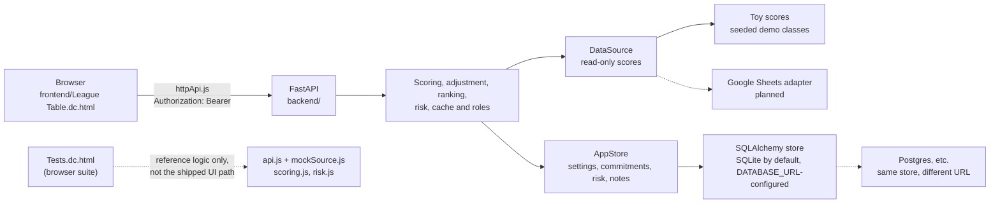

# Architecture and layout

How the pieces fit and where files live.

## How it works

- The contract is [`openapi.yaml`](../openapi.yaml). `frontend/services/httpApi.js` is the live client the shipped page uses; `frontend/services/api.js` + `mockSource.js` are a client-side reference implementation of the same contract, exercised only by the browser test suite (`tests.js`/`Tests.dc.html`), not by the running app. A contract test checks the running app against `openapi.yaml`.
- Scores come through a read-only `DataSource`. Today that is two seeded toy classes of 24 students, 16 weeks, and 5 criteria each, including a tie, a missing entry, a perfect week, a zero week, and a late joiner. Entries run through all 16 weeks, so week 16 is the landing week.
- The read-write `AppStore` holds everything the service owns: league settings, baselines, weekly updates, risk settings and snapshots, and instructor notes. SQLAlchemy backs it against the database `DATABASE_URL` names. By default that is SQLite in memory, a fresh, empty store on every run. Set `DATABASE_URL` to a file (`sqlite:///./league_table.db`) or to another SQLAlchemy-supported database, such as the Neon Postgres the deployed services use, to keep data.
- Reads are cached for 60 seconds. If the source fails, the last good snapshot is served and marked stale. Refresh is rate-limited to once every 10 seconds.
- Problems in the data, such as an unknown student ID, are listed instead of breaking the table.

## Project layout

| Path | What is in it |
| --- | --- |
| [`ops/alerts/`](../ops/alerts) | The exported Grafana alert rule and its evidence |
| [`render.yaml`](../render.yaml) | The Render Blueprint for the dev and prod services |
| [`e2e/`](../e2e) | The Playwright browser tests |
| [`.github/workflows/`](../.github/workflows) | CI and the deploy workflows |
| [`frontend/`](../frontend) | The page and its services layer: `httpApi.js` (the live client, used by the page) plus `api.js`/`mockSource.js`/`scoring.js`/`risk.js` (a reference implementation exercised only by the browser test suite `tests.js`) |
| [`backend/`](../backend) | The FastAPI service and its pytest suite. See [`backend/README.md`](../backend/README.md) |
| [`openapi.yaml`](../openapi.yaml) | The API contract |
| [`spec.md`](spec.md) | The product spec: goals, scoring rules, data model, and phasing |
